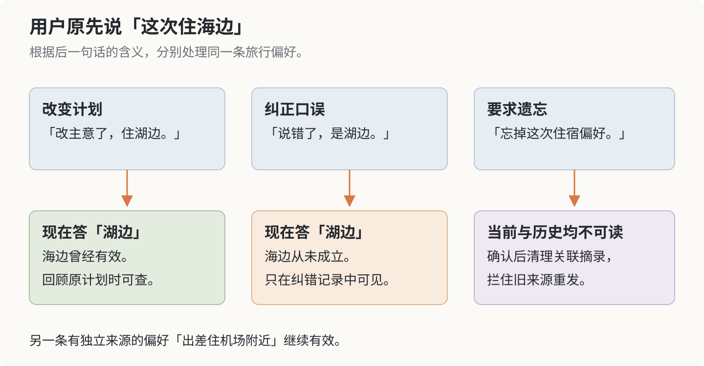

# MemoSphere

**给 AI 助手一份可以回看、纠正和删除的长期记忆。**

你先说“想住海边”，几天后又说“改住湖边”。下次做推荐，助手应该优先考虑湖边。如果你说的是“上次讲错了”，回顾原计划时也应该纠正那次口误。MemoSphere 保存事实、变更时间和原话，让接入的助手能区分这两种情况。

[打开记忆控制台](https://memosphere.mlxb.cc/) · [客户端接入协议](docs/客户端接入协议.md) · [本地启动](#本地启动)



## 一段对话如何成为记忆

| 环节 | MemoSphere 做什么 |
| --- | --- |
| 写入 | 客户端提交已授权的对话。后台提取事实，关联来源，把补充、更正和冲突分别处理。 |
| 召回 | 助手按账号、项目和连接权限检索。当前事实用于做建议，历史问题可以追溯到当时的证据。 |
| 管理 | 用户在控制台查看来源、修改或删除记忆，也可以单独撤销某个助手的访问权限。 |

## 两种接入方式

**给自己的助手用。** 在控制台创建项目，为 Codex 或 Kimi Code 分别授权。通用 MCP 客户端也能通过 `/mcp/` 读写记忆。桌面端自动采集对话还需安装对应的 Hook，选定允许采集的工作目录。

**给产品用。** 宿主应用通过私有 HTTP API 传入自己的用户标识。KoKo 使用这种方式，让用户直接在 iPhone 里查看和纠正自己的记忆。接口、鉴权和请求示例见[客户端接入协议](docs/客户端接入协议.md)。

## 本地启动

在仓库根目录运行以下命令，可启动 Go 服务、SQLite 数据库和 Web 控制台。这个最小配置使用词法检索，无需下载向量模型。

```sh
mkdir -p .runtime
MEMOSPHERE_RETRIEVAL=lexical go run ./cmd/memosphere
```

打开[本地控制台](http://127.0.0.1:18800/)。注册和登录需要配置 SMTP 以接收验证码。启用自动整理时，通过 `MEMOSPHERE_MODEL_CONFIG` 指定仅服务端可读的模型配置。完整配置、混合检索和已有数据库的升级步骤见[运行手册](docs/数据迁移与运行手册.md)。

## 代码入口

| 目录 | 内容 |
| --- | --- |
| [cmd/memosphere](cmd/memosphere) | 独立控制台与宿主应用模式的服务入口 |
| [internal/memory](internal/memory) | 来源存储、事实修订、召回与访问控制 |
| [internal/embedding](internal/embedding) | 本地及远程文本向量编码 |
| [memosphere](memosphere) | 桌面接入组件与控制台资源 |
